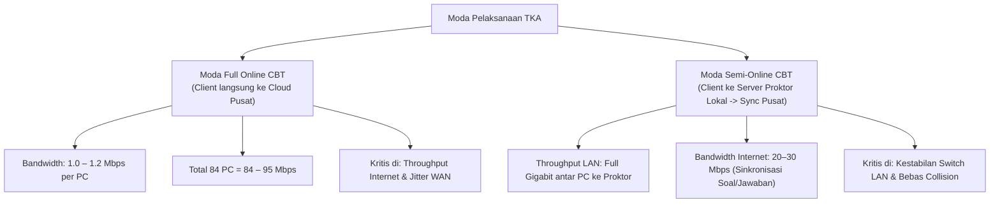
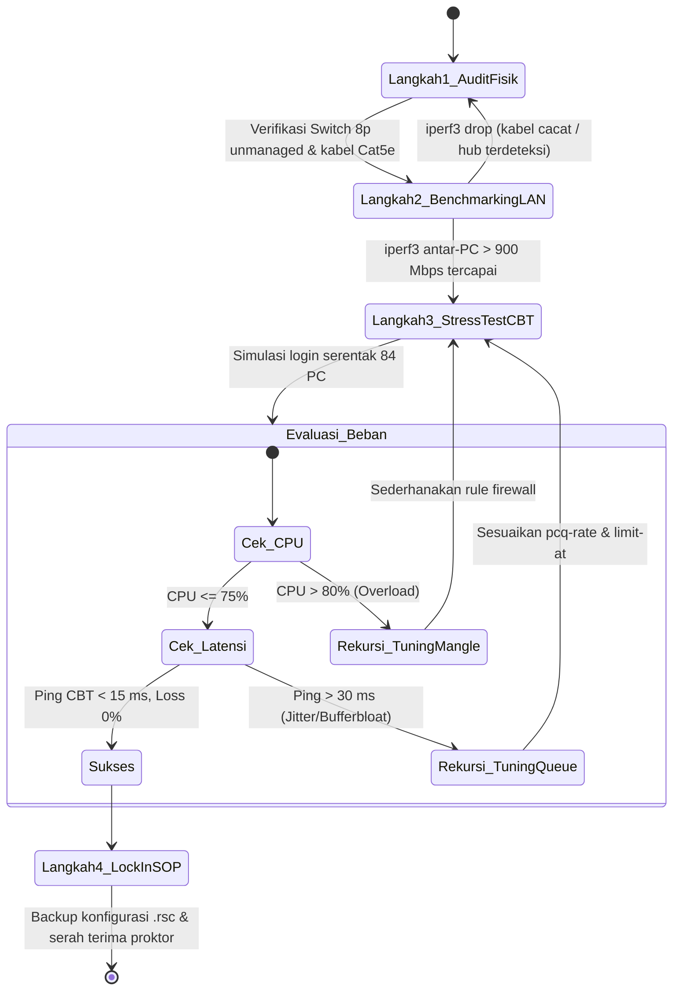

# Analisis & Strategi Jaringan Prioritas TKA (Tes Kemampuan Akademik)
## Network Assessment & Optimization — SMK Informatika Pasundan

| Parameter | Keterangan |
|---|---|
| **Mata Kuliah** | Proyek Konsultansi — Kelas 5A SISTEL |
| **Mitra** | SMK Informatika Pasundan |
| **Fokus Utama** | **Kesiapan Infrastruktur 2 Lab (80–84 PC) untuk Pelaksanaan TKA/CBT** |
| **Prinsip Solusi** | *Zero-Cost Optimization* (Memaksimalkan aset idle tanpa pengadaan baru) |
| **Pendekatan** | **Rekursif & Selaras (Problem ↔ Constraint ↔ Solution ↔ Tuning)** |
| **Deliverable** | Topologi Realistis, Fishbone Risiko TKA, Script MikroTik Lengkap, SOP Proktor |

---

## 1. Executive Summary: Penyelarasan Problem Statement & Realita Lapangan

Pelaksanaan TKA (Tes Kemampuan Akademik / ANBK / Ujian Sekolah) adalah aktivitas **berisiko tinggi (*high-stakes event*)** yang melibatkan **80–84 unit PC** secara simultan pada jam 08.00–13.00.

Berdasarkan audit mendalam terhadap aset sekolah, terdapat batasan (*constraints*) fisik dan logis yang harus dijawab secara berbanding lurus:
1. **Batasan IP WAN ISP**: Sekolah berlangganan Fibernet 100 Mbps Dedicated. Jika ISP hanya memberikan **1 IP Publik (/30)**, maka dua router tidak bisa terhubung paralel ke ISP tanpa skema khusus.
2. **Batasan Port Switch Fisik**: Sekolah memiliki **5 unit Switch 16-Port Gigabit TP-Link** (maksimal 70–71 port usable setelah dikurangi port cascade). Sisa 12–14 PC lab harus didukung oleh Switch 8-Port TP-Link/Tenda yang dipastikan beroperasi pada mode *unmanaged switch (full-duplex)*, bukan hub half-duplex.
3. **Batasan Komputasi Router hAP lite**: Router MikroTik hAP lite memiliki CPU single-core 650 MHz dan RAM 32MB. Menangani 84 koneksi konstan dengan Queue Tree (tanpa FastTrack) akan mendorong CPU ke kisaran **60%–75%**. Konfigurasi firewall wajib dirancang seringan mungkin (*lightweight mangle*).

Dokumen ini menyajikan pemecahan masalah yang **berbanding lurus dengan batasan tersebut** serta menerapkan metode **penyempurnaan secara rekursif**.

---

## 2. Analisis Kebutuhan Bandwidth & Moda Pelaksanaan CBT



### Kalkulasi Bandwidth Berdasarkan Batasan 100 Mbps Fibernet:
* Kapasitas Riil ISP: $\approx 95 \text{ Mbps}$ (setelah overhead transmisi).
* Alokasi Dedicated TKA saat Sesi Ujian: **75–80 Mbps (CIR / limit-at)**.
* Sisa Bandwidth untuk Operasional Guru & Administrasi: **15–20 Mbps (Hard Cap / max-limit)**.
* Akses WiFi BYOD Siswa di Selasar: **Dinonaktifkan / dibatasi 5 Mbps** selama sesi TKA berlangsung.

---

## 3. Analisis Risiko Kegagalan TKA (Diagram Fishbone Ishikawa)


### Matriks Masalah ↔ Solusi Berbanding Lurus:

| No | Risiko / Kendala Lapangan | Akar Penyebab Teknis | Solusi yang Berbanding Lurus |
|:---:|---|---|---|
| **1** | ISP hanya menyediakan 1 IP Publik (/30) | Keterbatasan paket sewa ISP | **Mode TKA Dedicated Gateway**: Kabel WAN ISP diarahkan ke Router #2 saat hari ujian, atau Router #1 menjadi WAN Edge dengan VLAN/Subnet murni ke Lab. |
| **2** | Port Switch 16-Port hanya 5 unit (kurang 13 port) | 5 × 14 port cascade = 70 port untuk 84 PC | Mengombinasikan **5 Switch 16-Port Gigabit + Switch 8-Port TP-Link unmanaged** di ujung baris PC. (Audit Form 2 memastikan tidak ada Hub murni). |
| **3** | CPU hAP lite rentan 100% | Single-core 650 MHz memproses mangle & queue 84 PC | Mangle disederhanakan dengan `src-address-list`, hindari deep packet inspection, targetkan CPU stabil di **60–75%**. |
| **4** | Uplink Switch ke Router hAP lite 100 Mbps | Port hAP lite adalah Fast Ethernet (10/100) | Komunikasi antar PC ke server lokal lab tetap 1000 Mbps; uplink internet 100 Mbps sudah sesuai dengan batas langganan ISP 100 Mbps. |
| **5** | Sesi ujian logout mendadak | Windows Update serentak / DHCP lease renewal | Matikan service `wuauserv` di 84 PC dan set DHCP lease-time menjadi **3 hari**. |

---

## 4. Arsitektur Jaringan Realistis ("TKA-First Architecture")


### Desain Distribusi Port & Perangkat Lab:
1. **Lab TJKT (42 PC)**:
   * 2 Unit Switch 16-Port Gigabit TP-Link (menampung 28 PC).
   * 1 Unit Switch 16-Port Gigabit TP-Link (menampung 14 PC + Uplink).
   * *Subnet:* `192.168.20.0/24` (Gateway: `192.168.20.1`).
2. **Lab MP (40 PC)**:
   * 2 Unit Switch 16-Port Gigabit TP-Link (menampung 28 PC).
   * 2 Unit Switch 8-Port TP-Link/Tenda Unmanaged (menampung 12 PC).
   * *Subnet:* `192.168.21.0/24` (Gateway: `192.168.21.1`).
3. **Ruang Proktor & Server Ujian**:
   * Port khusus `ether4` di router (`192.168.22.0/24`) terhubung ke Server Proktor lokal dan PC monitoring dengan prioritas antrean tertinggi.

---

## 5. Implementasi Skrip MikroTik Lengkap (Ready-to-Deploy)

Skrip berikut telah dilengkapi rule **NAT Masquerade**, **DNS Server Caching**, dan **Lightweight Mangle** untuk menjaga clock CPU router hAP lite tetap dingin.

```routeros
# ====================================================================
# 1. PENGATURAN INTERFACE & PENAMAAN PORT
# ====================================================================
/interface ethernet
set [ find default-name=ether1 ] name=ether1-WAN comment="Uplink ke Switch/Modem Fibernet"
set [ find default-name=ether2 ] name=ether2-LAB-TJKT comment="Ke Switch Gigabit Lab TJKT (42 PC)"
set [ find default-name=ether3 ] name=ether3-LAB-MP comment="Ke Switch Lab MP (40 PC)"
set [ find default-name=ether4 ] name=ether4-PROKTOR comment="Ke Server & PC Proktor"

# ====================================================================
# 2. PENGALAMATAN IP ADDRESS
# ====================================================================
/ip address
# Sesuaikan IP ether1 dengan IP dari ISP Fibernet (Contoh IP Statis /30)
# add address=103.x.x.2/30 interface=ether1-WAN network=103.x.x.0
add address=192.168.20.1/24 interface=ether2-LAB-TJKT network=192.168.20.0
add address=192.168.21.1/24 interface=ether3-LAB-MP network=192.168.21.0
add address=192.168.22.1/24 interface=ether4-PROKTOR network=192.168.22.0

# ====================================================================
# 3. DNS SERVER & CACHING (MEMPERCEPAT RESOLVING WEB CBT)
# ====================================================================
/ip dns
set allow-remote-requests=yes cache-size=2048KiB servers=8.8.8.8,1.1.1.1

# ====================================================================
# 4. DHCP SERVER (LEASE TIME 3 HARI MENCEGAH DISCONNECT SAAT UJIAN)
# ====================================================================
/ip pool
add name=pool-tjkt ranges=192.168.20.10-192.168.20.60
add name=pool-mp ranges=192.168.21.10-192.168.21.60
add name=pool-proktor ranges=192.168.22.10-192.168.22.20

/ip dhcp-server
add address-pool=pool-tjkt disabled=no interface=ether2-LAB-TJKT lease-time=3d name=dhcp-tjkt
add address-pool=pool-mp disabled=no interface=ether3-LAB-MP lease-time=3d name=dhcp-mp
add address-pool=pool-proktor disabled=no interface=ether4-PROKTOR lease-time=3d name=dhcp-proktor

/ip dhcp-server network
add address=192.168.20.0/24 dns-server=192.168.20.1,8.8.8.8 gateway=192.168.20.1
add address=192.168.21.0/24 dns-server=192.168.21.1,8.8.8.8 gateway=192.168.21.1
add address=192.168.22.0/24 dns-server=192.168.22.1,8.8.8.8 gateway=192.168.22.1

# ====================================================================
# 5. FIREWALL NAT (MASQUERADE OUTBOUND WAN)
# ====================================================================
/ip firewall nat
add chain=srcnat out-interface=ether1-WAN action=masquerade comment="NAT Internet Sekolah"

# ====================================================================
# 6. LIGHTWEIGHT MANGLE (HEMAT CPU 650 MHz DENGAN ADDRESS-LIST)
# ====================================================================
/ip firewall address-list
add address=192.168.20.0/24 list=LIST-TKA comment="Lab TJKT"
add address=192.168.21.0/24 list=LIST-TKA comment="Lab MP"
add address=192.168.22.0/24 list=LIST-PROKTOR comment="Server & Proktor"

/ip firewall mangle
# Tandai koneksi Proktor (Super Priority)
add chain=forward src-address-list=LIST-PROKTOR action=mark-connection new-connection-mark=conn-proktor passthrough=yes comment="PROKTOR"
add chain=forward connection-mark=conn-proktor action=mark-packet new-packet-mark=pkt-proktor passthrough=no

# Tandai koneksi 84 PC Klien Lab TKA
add chain=forward src-address-list=LIST-TKA action=mark-connection new-connection-mark=conn-tka passthrough=yes comment="TKA CLIENTS"
add chain=forward connection-mark=conn-tka src-address-list=LIST-TKA action=mark-packet new-packet-mark=pkt-tka-up passthrough=no
add chain=forward connection-mark=conn-tka dst-address-list=LIST-TKA action=mark-packet new-packet-mark=pkt-tka-down passthrough=no

# ====================================================================
# 7. QUEUE TREE DENGAN PCQ (FAIRNESS PER PC UJIAN)
# ====================================================================
/queue type
add name=pcq-tka-down kind=pcq pcq-classifier=dst-address pcq-rate=2M
add name=pcq-tka-up   kind=pcq pcq-classifier=src-address pcq-rate=1M

/queue tree
add name=TOTAL-DOWNLOAD parent=global max-limit=95M
add name=TOTAL-UPLOAD   parent=global max-limit=95M

# Prioritas 1: Server Proktor (Garansi 10M, Maks 90M)
add name=Q-PROKTOR-DOWN parent=TOTAL-DOWNLOAD packet-mark=pkt-proktor limit-at=10M max-limit=90M priority=1 queue=default
add name=Q-PROKTOR-UP   parent=TOTAL-UPLOAD   packet-mark=pkt-proktor limit-at=10M max-limit=90M priority=1 queue=default

# Prioritas 2: 84 PC Lab Klien (Garansi 70M, Maks 85M dengan pembagian PCQ 2 Mbps per PC)
add name=Q-TKA-DOWN parent=TOTAL-DOWNLOAD packet-mark=pkt-tka-down limit-at=70M max-limit=85M priority=2 queue=pcq-tka-down
add name=Q-TKA-UP   parent=TOTAL-UPLOAD   packet-mark=pkt-tka-up   limit-at=70M max-limit=85M priority=2 queue=pcq-tka-up

# Prioritas 8: Trafik Luar / Non-TKA (Dibatasi Keras Maks 15M)
add name=Q-NON-TKA-DOWN parent=TOTAL-DOWNLOAD packet-mark=no-mark limit-at=2M max-limit=15M priority=8 queue=default
add name=Q-NON-TKA-UP   parent=TOTAL-UPLOAD   packet-mark=no-mark limit-at=2M max-limit=15M priority=8 queue=default
```

---

## 6. Prosedur Penyelesaian Rekursif (Recursive Tuning Workflow)

Untuk memastikan sistem tidak hanya dirancang di atas kertas tetapi terbukti andal saat hari-H, konsultan menerapkan siklus **4 Langkah Rekursif**:



### Panduan Aksi Rekursif:
1. **Jika saat Stress Test CPU hAP lite > 80%**:
   * Nonaktifkan sementara paket mangle upload, cukup lakukan pembatasan di download (`dst-address`).
   * Turunkan connection tracking timeout UDP dari default 3 menit ke 30 detik (`/ip firewall connection tracking set udp-timeout=30s`).
2. **Jika terjadi antrean jawaban CBT lambat terkirim**:
   * Naikkan alokasi `pcq-rate` upload dari 1M menjadi 1.5M per PC.
   * Matikan interface WiFi internal router hAP lite (`/interface wireless disable [find]`) untuk menghemat clock core CPU.

---

## 7. SOP & Checklist Gladi Bersih Proktor TKA

### Checklist H-2 Sebelum Gladi Bersih:
- [ ] Seluruh kabel switch lab terpasang kuat, lampu LED port menunjukkan status Gigabit (hijau/kuning stabil).
- [ ] Script MikroTik di atas telah di-*restore* ke Router #2.
- [ ] Seluruh PC lab telah diuji mendapat IP address otomatis dalam rentang `192.168.20.x` dan `192.168.21.x`.
- [ ] Layanan *Windows Update* telah dimatikan di seluruh PC peserta ujian.

### Checklist Pelaksanaan Hari-H Ujian:
- [ ] SSID WiFi publik siswa dipastikan dalam kondisi *Disabled*.
- [ ] Proktor memantau Winbox menu `/queue tree` memastikan antrean `Q-TKA-DOWN` berstatus hijau/kuning (tidak merah).
- [ ] Modem 4G cadangan disiagakan di meja proktor dan telah dites dapat terhubung ke server pusat jika terjadi insiden fiber optik ISP putus.
