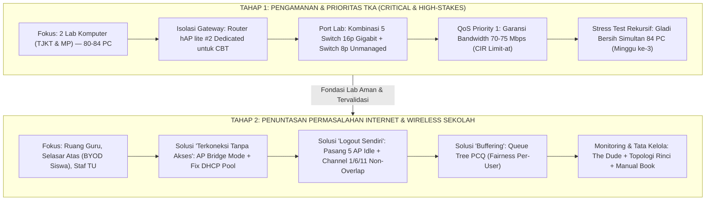
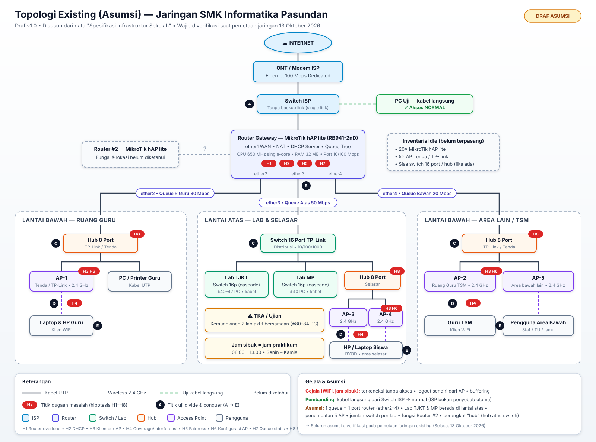
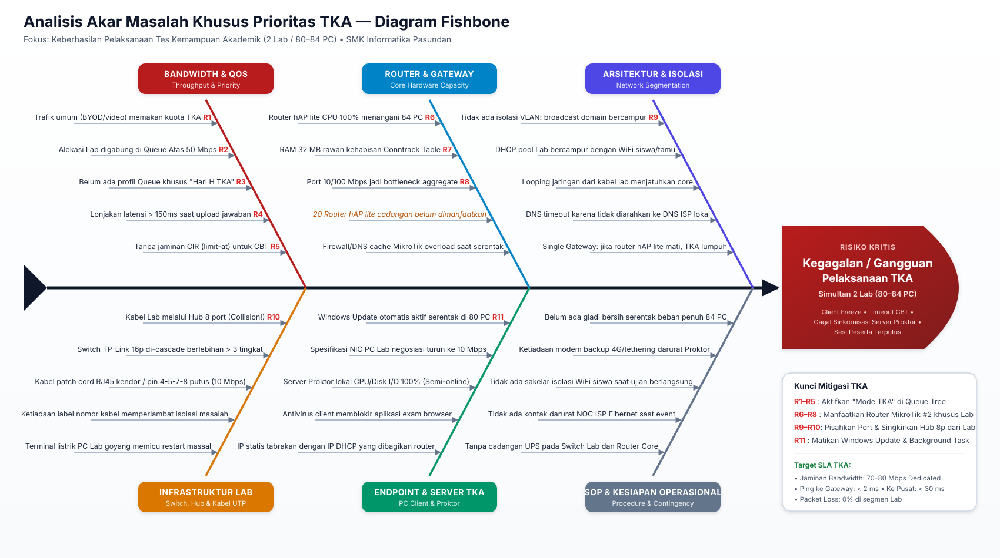
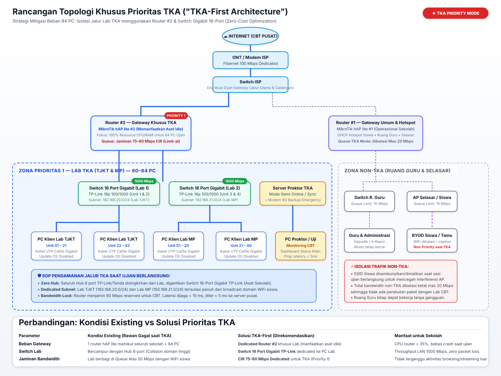
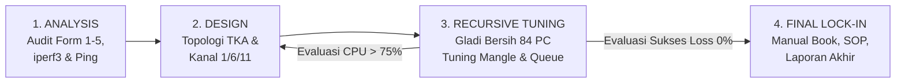

# Brainstorming & Analysis Plan (Master Plan 2-Tahap)
## Network Assessment & Optimization Jaringan Sekolah — SMK Informatika Pasundan

| Item | Keterangan |
|---|---|
| **Mata Kuliah** | Proyek Konsultansi — Kelas 5A SISTEL |
| **Mitra** | SMK Informatika Pasundan |
| **Peran Tim** | Konsultan Infrastruktur Jaringan (Network Administrator) |
| **Periode Proyek** | 5 – 26 Oktober 2026 |
| **Status Dokumen** | **Master Plan v2.1 — Rekursif & Selaras dengan Batasan Fisik/Logis Lapangan** |
| **Prinsip Utama** | *Problem ↔ Constraint ↔ Solution ↔ Recursive Closed-Loop Tuning* |

---

## 1. Pendekatan Strategis: Rencana Bertahap & Rekursif (Two-Phase Strategy)

Berdasarkan batasan riil perangkat (*hardware limits*) dan alur RPS konsultasi, proyek dibagi secara terstruktur ke dalam **2 Tahap Berkelanjutan**:



---

## 2. Kondisi Existing, Batasan Lapangan & Temuan Awal (As-Is)

### 2.1 Rekap Data Spesifikasi & Batasan Riil (*Constraints*)

| No | Komponen | Data dari Sekolah | Batasan Teknis Lapangan (*Constraint*) | Solusi Konsultan yang Berbanding Lurus |
|---|---|---|---|---|
| 1 | **Layanan ISP** | Fibernet 100 Mbps Dedicated | Mayoritas ISP sekolah memberikan **1 IP Publik (/30)** atau single PPPoE. | Skema *Dedicated Exam Gateway*: saat ujian berlangsung, kabel WAN dialihkan ke Router #2 khusus TKA. |
| 2 | **Router Gateway** | MikroTik hAP lite (RB941-2nD) (2 terpakai, **20 idle**) | CPU 650 MHz single-core & RAM 32MB. Tanpa FastTrack, CPU peak mencapai 60%–75%. | Gunakan rule Mangle ringan berbasis `address-list` untuk menjaga CPU stabil di < 75%. |
| 3 | **Switch & Hub** | Switch TP-Link 16p Gigabit (5 unit) & Hub 8p (3 unit) | 5 switch 16p cascade hanya menyediakan **70 port usable**, kurang 14 port untuk 84 PC. | Kombinasikan **5 Switch 16p Gigabit + Switch 8p unmanaged** di ujung meja (Form 2 memverifikasi tidak ada hub half-duplex). |
| 4 | **Port Uplink Router** | Port Router hAP lite Fast Ethernet (10/100M) | Uplink dari switch gigabit ke router hAP lite negosiasi pada 100 Mbps. | Throughput antar-PC lab tetap 1000 Mbps gigabit; uplink 100 Mbps sudah cukup untuk internet ISP 100 Mbps. |
| 5 | **Access Point** | Tenda & TP-Link (5 terpasang, **5 idle**) | AP kelas rumahan overload; interferensi kanal 2.4 GHz saling tindih. | Pasang 5 AP idle (total 10 AP), set Bridge Mode (DHCP off), terapkan kanal 1/6/11 non-overlap. |
| 6 | **Gejala Masalah** | 08.00–13.00: No access, logout sendiri, buffering | DHCP pool habis, double NAT AP, dan Queue Tree statis tanpa fairness. | DHCP pool `/23` lease 1 jam, PCQ fairness per-user, dan sistem borrowing bandwidth. |

### 2.2 Topologi Existing Eksisting (Asumsi Awal)



---

## 3. TAHAP 1: Prioritas Pengamanan & Optimasi Jalur TKA

### 3.1 Problem Statement Tahap 1
> *"Pelaksanaan TKA (Tes Kemampuan Akademik / ANBK / Ujian Berbasis Komputer) melibatkan 80–84 PC di Lab TJKT dan Lab MP secara simultan pada jam sibuk 08.00–13.00. Ketiadaan jaminan bandwidth, risiko CPU router 650 MHz crash, dan keterbatasan 70 port switch gigabit berpotensi menggagalkan sesi ujian peserta."*

### 3.2 Analisis Risiko TKA (Fishbone Ishikawa)



*Tabel Mitigasi 6 Tulang Masalah TKA Berbanding Lurus:*
1. **Bandwidth & QoS**: Mengunci alokasi `limit-at=70M` dengan `priority=2` (setelah Proktor `priority=1`) pada Queue Tree khusus TKA saat sesi ujian berlangsung.
2. **Router Gateway**: Memisahkan gateway lab ke **Router MikroTik #2** (aset idle) agar 100% CPU/RAM melayani paket CBT.
3. **Arsitektur & Isolasi**: Lab TJKT (`192.168.20.0/24`) dan Lab MP (`192.168.21.0/24`) diisolasi dari broadcast domain WiFi siswa.
4. **Infrastruktur Lab**: Mengombinasikan 5 Switch 16-Port Gigabit + Switch 8-Port unmanaged (bebas hub half-duplex) untuk menjamin 84 PC terhubung fisik.
5. **Endpoint PC**: Menonaktifkan service Windows Update otomatis (`wuauserv`) sebelum simulasi dan hari-H.
6. **SOP & Proktor**: Menyiapkan 1 modem 4G cadangan di ruang proktor dan menggelar gladi bersih beban penuh 84 PC secara rekursif.

### 3.3 Topologi Solusi Tahap 1 ("TKA-First Architecture")



### 3.4 Skrip Konfigurasi MikroTik Gateway TKA (Lengkap dengan NAT & DNS)
```routeros
# ====================================================================
# KONFIGURASI ROUTER #2 KHUSUS LAB TKA (LENGKAP NAT + DNS + QOS)
# ====================================================================
/interface ethernet
set [ find default-name=ether1 ] name=ether1-WAN comment="Uplink Switch/Modem ISP Fibernet"
set [ find default-name=ether2 ] name=ether2-LAB-TJKT comment="Ke Switch Gigabit Lab TJKT (42 PC)"
set [ find default-name=ether3 ] name=ether3-LAB-MP comment="Ke Switch Lab MP (40 PC)"
set [ find default-name=ether4 ] name=ether4-PROKTOR comment="Ke Server & PC Proktor"

/ip address
add address=192.168.20.1/24 interface=ether2-LAB-TJKT network=192.168.20.0
add address=192.168.21.1/24 interface=ether3-LAB-MP network=192.168.21.0
add address=192.168.22.1/24 interface=ether4-PROKTOR network=192.168.22.0

/ip dns
set allow-remote-requests=yes cache-size=2048KiB servers=8.8.8.8,1.1.1.1

/ip pool
add name=pool-tjkt ranges=192.168.20.10-192.168.20.60
add name=pool-mp ranges=192.168.21.10-192.168.21.60
add name=pool-proktor ranges=192.168.22.10-192.168.22.20

/ip dhcp-server
add address-pool=pool-tjkt disabled=no interface=ether2-LAB-TJKT lease-time=3d name=dhcp-tjkt
add address-pool=pool-mp disabled=no interface=ether3-LAB-MP lease-time=3d name=dhcp-mp
add address-pool=pool-proktor disabled=no interface=ether4-PROKTOR lease-time=3d name=dhcp-proktor

/ip dhcp-server network
add address=192.168.20.0/24 dns-server=192.168.20.1,8.8.8.8 gateway=192.168.20.1
add address=192.168.21.0/24 dns-server=192.168.21.1,8.8.8.8 gateway=192.168.21.1
add address=192.168.22.0/24 dns-server=192.168.22.1,8.8.8.8 gateway=192.168.22.1

/ip firewall nat
add chain=srcnat out-interface=ether1-WAN action=masquerade comment="NAT Internet Sekolah"

/ip firewall address-list
add address=192.168.20.0/24 list=LIST-TKA comment="Lab TJKT"
add address=192.168.21.0/24 list=LIST-TKA comment="Lab MP"
add address=192.168.22.0/24 list=LIST-PROKTOR comment="Server Proktor"

/ip firewall mangle
add chain=forward src-address-list=LIST-PROKTOR action=mark-connection new-connection-mark=conn-proktor passthrough=yes comment="PROKTOR"
add chain=forward connection-mark=conn-proktor action=mark-packet new-packet-mark=pkt-proktor passthrough=no
add chain=forward src-address-list=LIST-TKA action=mark-connection new-connection-mark=conn-tka passthrough=yes comment="TKA CLIENTS"
add chain=forward connection-mark=conn-tka src-address-list=LIST-TKA action=mark-packet new-packet-mark=pkt-tka-up passthrough=no
add chain=forward connection-mark=conn-tka dst-address-list=LIST-TKA action=mark-packet new-packet-mark=pkt-tka-down passthrough=no

/queue type
add name=pcq-tka-down kind=pcq pcq-classifier=dst-address pcq-rate=2M
add name=pcq-tka-up   kind=pcq pcq-classifier=src-address pcq-rate=1M

/queue tree
add name=TOTAL-DOWNLOAD parent=global max-limit=95M
add name=TOTAL-UPLOAD   parent=global max-limit=95M
add name=Q-PROKTOR-DOWN parent=TOTAL-DOWNLOAD packet-mark=pkt-proktor limit-at=10M max-limit=90M priority=1 queue=default
add name=Q-PROKTOR-UP   parent=TOTAL-UPLOAD   packet-mark=pkt-proktor limit-at=10M max-limit=90M priority=1 queue=default
add name=Q-TKA-DOWN parent=TOTAL-DOWNLOAD packet-mark=pkt-tka-down limit-at=70M max-limit=85M priority=2 queue=pcq-tka-down
add name=Q-TKA-UP   parent=TOTAL-UPLOAD   packet-mark=pkt-tka-up   limit-at=70M max-limit=85M priority=2 queue=pcq-tka-up
add name=Q-NON-TKA-DOWN parent=TOTAL-DOWNLOAD packet-mark=no-mark limit-at=2M max-limit=15M priority=8 queue=default
add name=Q-NON-TKA-UP   parent=TOTAL-UPLOAD   packet-mark=no-mark limit-at=2M max-limit=15M priority=8 queue=default
```

---

## 4. TAHAP 2: Penuntasan Masalah Internet & Wireless Harian Sekolah

Setelah jalur lab TKA diamankan, Tahap 2 fokus menuntaskan akar penyebab dari 3 keluhan utama pada jaringan harian:

### 4.1 Penyelesaian Masalah 1: "Terkoneksi ke AP tapi Tidak Ada Akses"
* **Akar Masalah**:
  1. *Rogue DHCP / Double NAT*: AP diset pada mode router sehingga membagikan IP sendiri yang tidak ter-routing ke internet.
  2. *DHCP Pool Exhaustion*: Jumlah perangkat BYOD siswa melebihi kapasitas subnet `/24` (maks 254 IP) ditambah lease time yang terlalu lama (misal 3 hari) sehingga IP habis.
* **Solusi Berbanding Lurus**:
  - Ubah seluruh AP (Tenda & TP-Link) ke mode **Access Point / Bridge Mode**. Port WAN AP tidak digunakan (atau diset Bridge LAN).
  - Matikan fitur DHCP Server pada seluruh AP; DHCP tersentralisasi di MikroTik Router #1.
  - Perluas pool DHCP area siswa ke subnet `/23` (510 host) dengan **lease time singkat (1 jam)**.

### 4.2 Penyelesaian Masalah 2: "Logout / Terputus Sendiri dari AP (Khususnya di Ruang Guru)"
* **Akar Masalah**:
  1. *Hardware Limit (Overload)*: AP Tenda seri consumer memiliki memori dan prosesor sangat kecil. Saat menampung lebih dari 3-5 *user* aktif secara bersamaan, sistem AP seringkali *overload* dan secara otomatis memutus (*kick*) perangkat yang sudah tersambung demi merespons *request* baru.
  2. *Interferensi & Channel Colliding*: AP bersebelahan berada di frekuensi yang sama pada pita 2.4 GHz.
* **Solusi Opsi 1 (Zero-Cost / Memanfaatkan Aset Idle)**:
  - **Distribusi Beban dengan Multi-AP Tenda**: Memanfaatkan stok AP Tenda sekolah yang menganggur dengan memasang 2 hingga 3 unit AP sekaligus di area padat seperti Ruang Guru.
  - **Skema SSID Terpisah (Manual Failover)**: Memecah SSID menjadi beberapa nama (Contoh: `RuangGuru-1`, `RuangGuru-2`, `RuangGuru-3`). Dengan demikian, jika guru "terlempar" dari AP 1 karena penuh, mereka dapat segera beralih menyambungkan perangkatnya ke AP 2 atau AP 3.
  - **Kanal 1/6/11 Non-Overlap**: Mengatur ketiga AP tersebut secara *hardcode* ke Channel 1, 6, dan 11 agar pancaran sinyal ketiganya tidak saling bertabrakan (interferensi).
  - **Mode Bridge Mutlak**: Seluruh AP Tenda wajib diset menjadi *Access Point Mode* (Bukan Router Mode). DHCP Server di Tenda harus dimatikan agar beban manajemen IP di-*handle* sepenuhnya oleh Router Utama.
* **Solusi Opsi 2 (Rekomendasi Jangka Panjang)**:
  - Mengganti sekumpulan AP kelas rumahan tersebut dengan 1 unit AP kelas *Enterprise/SMB* (misalnya Ruijie Reyee, Ubiquiti UniFi, atau Aruba Instant On) yang secara *hardware* sanggup memegang 50–100 koneksi bersamaan tanpa memutus *client*.

### 4.3 Penyelesaian Masalah 3: "Buffering & Koneksi Lambat"
* **Akar Masalah**:
  1. Alokasi Queue Tree statis tanpa fairness: 1 user download IDM/torrent/video 4K dapat menghabiskan seluruh jatah 50 Mbps di area selasar.
  2. Port router hAP lite (100 Mbps) mengalami antrean paket (*bufferbloat*) saat CPU spike.
* **Solusi Berbanding Lurus**:
  - Terapkan mekanisme antrean **PCQ (Per Connection Queue)** di Router #1:
    - Setiap device guru mendapatkan alokasi adil max 3–5 Mbps.
    - Setiap device siswa/BYOD mendapatkan alokasi adil max 1–1.5 Mbps.
  - Terapkan sistem **Borrowing (Limit-at & Max-limit)**: Ruang Guru dijamin 20 Mbps, tetapi saat area siswa sepi, guru dapat meminjam hingga 60 Mbps secara dinamis.
  - Pasang firewall filter untuk memblokir port P2P/BitTorrent dan membatasi koneksi serentak per IP.

### 4.4 Monitoring & Visibilitas Jaringan
- Mengaktifkan **MikroTik Graphing** dan tool **The Dude** pada PC server lokal sekolah untuk memonitor:
  - Utilisasi bandwidth tiap interface real-time.
  - Beban CPU dan sisa RAM router gateway.
  - Jumlah klien aktif per access point.

---

## 5. Rencana Analisis & Pengujian Rekursif (Closed-Loop Tuning Plan)

Pengujian dilakukan bertahap dan berulang (*rekursif*) menggunakan siklus **NDLC Terpadu**:



### 5.1 Skema Pengujian Divide & Conquer (Titik A s.d. E)

| Titik | Lokasi Pengujian | Media | Target Pengujian | Standar Kelayakan |
|---|---|---|---|---|
| **A** | Switch ISP langsung | Kabel UTP | SLA ISP Fibernet (Kontrol H0) | Throughput ≥ 95 Mbps, Ping < 15 ms |
| **B** | Port LAN Router Gateway | Kabel UTP | Beban CPU, NAT & Queue (H1, H7) | Throughput ≥ 90 Mbps, CPU < 75% |
| **C** | Switch Distribusi Area / Lab | Kabel UTP | Kualitas kabel, verifikasi switch 8p (H8) | iperf3 LAN ≥ 900 Mbps (Gigabit) |
| **D** | Dekat AP (< 3 meter) | WiFi 2.4G | Kinerja AP murni & DHCP (H2, H6) | RSSI ≥ -50 dBm, Speed ≥ 30 Mbps |
| **E** | Titik Klien Terjauh / Selasar | WiFi 2.4G | Jangkauan & interferensi (H3, H4) | RSSI ≥ -68 dBm, Packet Loss < 2% |

### 5.2 Pembagian Jadwal Uji Jam Normal vs Jam Sibuk
* **Off-Peak (Kondisi Normal)**: Jumat 16 Oktober (Baseline kinerja tanpa beban siswa).
* **Peak (Jam Sibuk Sebenarnya)**: **Senin 19 Oktober (09.00–12.00)** untuk memvalidasi gejala buffering dan overload yang dilaporkan sekolah.

---

## 6. Roadmap Pelaksanaan Proyek (Diselaraskan dengan Timeline 26 Okt)

```mermaid
gantt
    title Roadmap Konsultasi 2-Tahap (Target Selesai: 26 Oktober 2026)
    dateFormat  YYYY-MM-DD
    section Minggu 1 (5–9 Okt): Legalitas & Konsep
    Finalisasi Konsep & Pembagian Tugas (Master Plan) :done, 2026-10-05, 1d
    Penyusunan & Pengajuan Draft PKS ke Sekolah     :active, 2026-10-06, 2d
    Finalisasi PKS & Instrumen Survey Lapangan      :2026-10-09, 1d
    section Minggu 2 (12–16 Okt): Audit & Fondasi Tahap 1
    Koordinasi Data Awal & Cek Router/Switch/ISP    :2026-10-12, 1d
    Pemetaan Wireless Existing & Inventarisasi AP   :2026-10-13, 1d
    Eksekusi Tahap 1: Verifikasi Switch Lab & Eliminasi Hub :2026-10-14, 2d
    Uji Baseline Off-Peak (Titik A-E) & Persiapan Slide :2026-10-16, 1d
    section Minggu 3 (19–23 Okt): Eksekusi Tahap 1 & 2
    Uji Jam Sibuk & Analisis Bandwidth TKA 84 PC    :2026-10-19, 1d
    Gladi Bersih Simultan TKA (Stress Test Rekursif 84 PC) :2026-10-20, 1d
    Eksekusi Tahap 2: Pasang 5 AP Idle & Re-tuning Channel :2026-10-21, 2d
    Rancangan Optimasi Final, Skrip QoS & SOP        :2026-10-23, 1d
    section Finalisasi (26 Okt): Deliverables
    Penyusunan Manual Book, Laporan Akhir & Presentasi :2026-10-26, 1d
```

---

## 7. Deliverables & Pembagian Peran Tim (7–8 Mahasiswa)

| Peran | Anggota | Fokus Deliverable |
|---|---|---|
| **Project Manager** | Anggota 1 | PKS, surat izin sekolah, koordinasi dengan kepala lab/wakasek, timekeeping. |
| **Lead Network Analyst (TKA)** | Anggota 2 & 3 | Konfigurasi Router #2, Switch Gigabit Lab, uji iperf3 84 PC, SOP Gladi Bersih TKA. |
| **Wireless & Coverage Specialist** | Anggota 4 & 5 | Survey heatmap, penempatan 5 AP idle, channel planning 1/6/11, tuning TX power. |
| **Gateway & QoS Engineer** | Anggota 6 | Penataan Queue Tree PCQ Router #1 (Guru/Siswa), segmentasi subnet, DHCP pool. |
| **Technical Writer & Documenter** | Anggota 7 & 8 | Pembuatan Manual Book konfigurasi, Topologi final draw.io/SVG, Laporan Akhir Proyek. |
