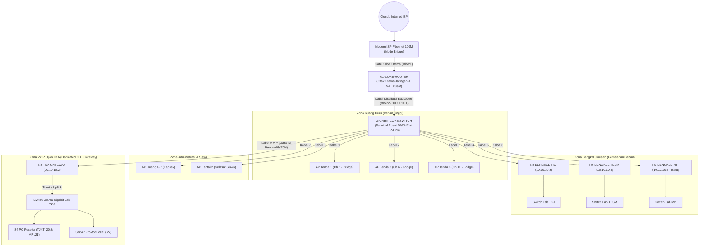
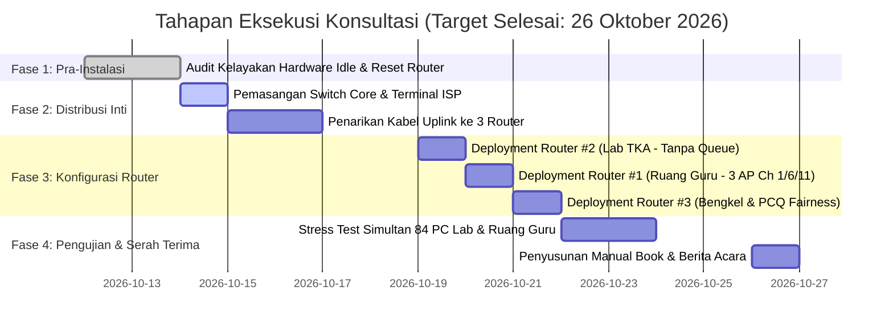

# Laporan Komprehensif: Assessment, Analisis Kebutuhan, dan Rencana Optimalisasi Infrastruktur Jaringan
**Mitra:** SMK Informatika Pasundan  
**Program:** Proyek Konsultansi — Kelas 5A SISTEL  
**Pendekatan Solusi:** *Distributed Zero-Cost Architecture* (Optimalisasi Aset Idle Tanpa Pengadaan Perangkat Keras Baru)  
**Target Penyelesaian:** 26 Oktober 2026  

---

## DAFTAR ISI RINGKAS
1. **BAB I — Latar Belakang, Profil Mitra, & Analisis Kebutuhan Sekolah**
2. **BAB II — Audit Menyeluruh & Temuan Data Lapangan (*As-Is Assessment*)**
   * 2.1 Bedah Kode Konfigurasi MikroTik (`backup.rsc`)
   * 2.2 Analisis Uji Throughput & Anomali Speedtest
   * 2.3 Analisis Spesifikasi Komputasi Router & Limitasi Hardware
   * 2.4 Evaluasi Topologi Eksisting, Jalur Daisy-Chain, & Opsi Darurat TKA
   * 2.5 Rekapitulasi Gejala Gangguan Pengguna (08.00–13.00)
3. **BAB III — Inventarisasi & Potensi Daya Ungkit Aset (*Capital Asset Audit*)**
4. **BAB IV — Desain Solusi: *Distributed Zero-Cost Architecture***
   * 4.1 Logika Pemecahan Beban ke 3 Router Independen
   * 4.2 Desain Distribusi Port & Eliminasi Bottleneck Lab TKA
   * 4.3 Rekayasa Wireless Ruang Guru & Penataan Kanal Bebas Interferensi
   * 4.4 Manajemen Bandwidth Dinamis (PCQ Fairness & Borrowing System)
5. **BAB V — Rencana Tahapan Eksekusi Lapangan (*Implementation Steps*)**
6. **BAB VI — Standar Pengujian, Metodologi Validasi, & Kriteria Serah Terima**
7. **BAB VII — Rencana Anggaran Biaya Bahan Habis Pakai & SOP Pemeliharaan**

---

## BAB I. Latar Belakang, Profil Mitra, & Analisis Kebutuhan Sekolah

### 1.1 Profil Sekolah & Karakteristik Wilayah Jaringan
SMK Informatika Pasundan merupakan institusi pendidikan kejuruan berbasis teknologi yang mengandalkan konektivitas data kecepatan tinggi untuk kegiatan belajar-mengajar harian, administrasi manajemen sekolah, dan praktikum kejuruan. Wilayah operasional jaringan sekolah terbagi ke dalam beberapa zona utama:
1. **Lantai Bawah (Zona Administrasi & Guru):**
   * Ruang Guru Utama: Tempat berkumpulnya puluhan guru dengan mobilitas perangkat nirkabel (laptop dan smartphone) yang sangat intensif.
   * Ruang Kepala Sekolah & Ruang Tata Usaha (TU): Membutuhkan keandalan koneksi stabil untuk pelaporan administrasi, dapodik, dan rapat daring.
2. **Lantai 1 & 2 (Zona Praktikum & Laboratorium Komputer):**
   * **Lab TJKT (Teknik Jaringan Komputer dan Telekomunikasi):** Berisi 42 unit PC *client*.
   * **Lab MP (Manajemen Perkantoran):** Berisi 40 unit PC *client*.
   * **Lab TSM (Teknik Sepeda Motor):** Kebutuhan praktikum kejuruan dan area guru kejuruan.
   * Total unit komputer di laboratorium mencapai **80–84 unit PC**.
3. **Zona Bengkel & Selasar Siswa:**
   * Bengkel TKJ & Bengkel TBSM: Area praktik siswa dengan kebutuhan akses data dan riset teknis.
   * Selasar Lantai Atas: Area publik siswa yang mengalami lonjakan akses (*BYOD - Bring Your Own Device*) pada jam istirahat dan jam pembelajaran.

### 1.2 Identifikasi Kebutuhan Riil Sekolah (*Requirements Analysis*)
Berdasarkan instrumen asesmen dan wawancara dengan penanggung jawab laboratorium serta pimpinan sekolah, kebutuhan mendesak sekolah dirumuskan sebagai berikut:
1. **Kebutuhan Ujian Berbasis Komputer (TKA / CBT / ANBK):**
   * Sekolah wajib menyelenggarakan simulasi dan pelaksanaan Tes Kemampuan Akademik (TKA) yang melibatkan 80–84 PC secara simultan pada rentang waktu 08.00–13.00.
   * Kebutuhan transmisi data pada moda *Full Online CBT* membutuhkan garansi *bandwidth* minimal 1.0–1.2 Mbps per PC secara stabil tanpa fluktuasi (*jitter* rendah, *zero packet loss*).
   * Kebutuhan pada moda *Semi-Online CBT* menuntut *throughput* lokal LAN sebesar 1 Gbps (Gigabit Ethernet) tanpa adanya *collision* paket data antar switch laboratorium ke server proktor.
   * **Ekspektasi Sekolah:** Menghilangkan kebiasaan lama yang tidak aman dan merepotkan, yaitu penarikan kabel LAN darurat menembus lorong dan gedung sekolah langsung ke modem ISP setiap kali ujian diselenggarakan.
2. **Kebutuhan Akses Nirkabel Ruang Guru yang Bebas Putus (*Zero Kick-out*):**
   * Guru membutuhkan konektivitas tanpa gangguan untuk input nilai, absensi digital, dan materi ajar interaktif.
   * Kapasitas akses nirkabel di Ruang Guru harus mampu menampung minimal 35–45 perangkat aktif secara serentak tanpa adanya perangkat yang terputus secara mendadak.
3. **Kebutuhan Keadilan Bandwidth (*Bandwidth Fairness*):**
   * Aktivitas praktikum pengunduhan berkas besar atau *streaming* di area bengkel siswa tidak boleh melumpuhkan koneksi internet di Ruang Guru dan Ruang Tata Usaha.
4. **Batasan Anggaran (*Zero-Cost Constraint*):**
   * Pihak sekolah tidak mengalokasikan anggaran untuk pembelian perangkat aktif utama seperti *Core Router* kelas industri (misal MikroTik CCR/RB4011 bernilai jutaan rupiah). Seluruh solusi wajib memanfaatkan secara maksimal aset sekolah yang sudah ada atau sedang menganggur (*idle*).

---

## BAB II. Audit Menyeluruh & Temuan Data Lapangan (*As-Is Assessment*)

### 2.1 Bedah Kode Konfigurasi MikroTik Eksisting (`backup.rsc`)
Pemeriksaan mendalam terhadap file cadangan konfigurasi (`backup.rsc`) dari router utama sekolah (MikroTik hAP lite RB941-2nD) mengungkap sejumlah anomali teknis mendasar yang menjadi akar kelumpuhan distribusi trafik:

#### A. Kesalahan Fatal Pembatasan Port Melalui *Simple Queue*
Di dalam file konfigurasi ditemukan aturan antrean berikut:
```routeros
/queue simple
add limit-at=10M/10M max-limit=10M/10M name=queue1 target=ether2
add limit-at=5M/5M max-limit=5M/5M name=queue3 target=ether3
add limit-at=5M/5M max-limit=5M/5M name=queue4 target=ether4
add max-limit=40M/40M name=queue2 queue=ethernet-default/ethernet-default target=wlan1
```
* **Temuan Tim:** Seluruh lalu lintas data yang melewati `ether3` dan `ether4` "dicekik" secara statis (*hard limit*) pada angka maksimal **5 Mbps (Upload & Download)**. Port `ether2` pun hanya diberikan batas maksimal **10 Mbps**.
* **Dampak Teknis:** Karena port `ether3` dan `ether4` digunakan sebagai jalur distribusi ke switch dan access point di gedung sekolah, seluruh pengguna di bawah port tersebut tidak akan pernah bisa menikmati kecepatan lebih dari 5 Mbps, kendati pipa langganan ISP memiliki kapasitas 100 Mbps.

#### B. Ketiadaan Fitur *FastTrack Connection*
Berdasarkan hasil tangkapan perintah terminal MikroTik (`/ip firewall filter print where action=fasttrack`), daftar rule filter berada dalam kondisi **kosong (nihil)**:
* **Temuan Tim:** Router beroperasi tanpa *FastTrack*.
* **Dampak Teknis:** Setiap paket data yang melintas wajib melewati seluruh rantai pemrosesan firewall dan *simple queue*. Akibatnya, prosesor kecil pada router hAP lite harus bekerja ekstra keras untuk memeriksa miliaran paket data secara manual.

#### C. Kesalahan Konfigurasi DNS Server Caching
Berdasarkan data tangkapan layar `/ip dns print`:
```text
allow-remote-requests: no
cache-size: 2048KiB
cache-used: 17KiB
```
* **Temuan Tim:** Fitur `allow-remote-requests` berada pada opsi `no`.
* **Dampak Teknis:** Router menolak melayani permintaan resolusi nama domain dari komputer *client* di jaringan lokal. Klien yang diarahkan ke IP gateway untuk DNS akan mengalami kegagalan resolusi atau mengalami waktu tunggu lama (*lookup latency* tinggi), yang memicu gejala halaman web berputar lama (*buffering/timeout*).

---

### 2.2 Analisis Uji Throughput & Anomali Speedtest
Tim konsultan melakukan serangkaian pengujian kecepatan menggunakan Ookla Speedtest pada titik-titik strategis untuk membuktikan dampak konfigurasi secara empiris:

| Titik Pengujian | Sumber Data / Gambar | Kecepatan Download | Kecepatan Upload | Latensi Ping (Idle / Load) | Evaluasi Konsultan |
|---|---|:---:|:---:|:---:|---|
| **Langsung di Modem ISP (Fibernet)** | `Router ISP.png` | **87.07 Mbps** | **45.56 Mbps** | 7 ms / 44 ms | Kapasitas riil ISP sangat sehat dan memenuhi SLA paket 100 Mbps Dedicated. |
| **Di Bawah Router Sekolah (hAP Lite)** | `Router Sekolah HAP Lite.png` | **4.78 Mbps** | **4.62 Mbps** | 6 ms / 114 ms | **Terjadi degradasi kecepatan >94%.** Hasil 4.78 Mbps mencerminkan batas 5 Mbps pada `queue3` & `queue4`. Latensi saat upload membengkak menjadi 114 ms (*Bufferbloat* parah). |
| **Access Point Ruang Guru** | `ACCES POINT RUANG GURU.png` | **62.23 Mbps** | **54.04 Mbps** | 8 ms / 32 ms | Jalur AP Ruang Guru langsung terhubung ke router ISP/Kepala Sekolah, membuktikan bahwa penurunan kecepatan hanya terjadi pada perangkat di bawah hAP Lite sekolah. |


*(Gambar 1: Uji Throughput Langsung pada Modem ISP Fibernet — Menembus 87.07 Mbps)*


*(Gambar 2: Uji Throughput di Bawah Router hAP Lite Sekolah — Tercekik di 4.78 Mbps)*

---

### 2.3 Analisis Spesifikasi Komputasi Router & Limitasi Hardware
Melalui pengujian diagnostik terminal MikroTik (`/system resource print` & `/system resource monitor`):
* **Model Perangkat:** MikroTik RouterBOARD 941-2nD (hAP lite).
* **Arsitektur CPU:** MIPS 24Kc V7.4 single-core @ 650 MHz.
* **Kapasitas RAM:** Total memori fisik hanya 32.0 MiB.
* **Memori Bebas (*Free Memory*):** Hanya tersisa **7.0 MiB hingga 7.2 MiB** saat kondisi beban rendah (*idle*).
* **Penyimpanan Flash (*Free HDD*):** Tersisa 3.5 MB dari total 16 MB.
* **Analisis Konsultan:** Router hAP lite adalah perangkat kelas SOHO (*Small Office Home Office*) rumahan. Mengandalkan 1 unit hAP lite dengan RAM sisa 7 MB untuk mengelola translasi NAT (*conntrack*), antrean data, dan tabel DHCP bagi lebih dari 150 perangkat aktif sekolah pada jam 08.00–13.00 merupakan tindakan yang secara teknis tidak dapat dipertahankan. Router akan mengalami *memory exhaustion* dan *CPU spike 100%*, yang berujung pada sistem membeku (*hang*) atau me-restart sendiri.


*(Gambar 3: Diagnostik Spesifikasi Komputasi Router — RAM Kritis Tersisa 7.0 MiB)*

---

### 2.4 Evaluasi Topologi Eksisting, Jalur Daisy-Chain, & Opsi Darurat TKA
Berdasarkan data pemetaan jaringan yang tertuang pada file `ASUMSI TOPOLOGI SEKOALAH.png`:


*(Gambar 4: Topologi Eksisting Sekolah — Menunjukkan Jalur Rantai Daisy-Chain dan Opsi Darurat)*

Dari topologi eksisting tersebut teridentifikasi empat kelemahan arsitektur kritis:
1. **Penyambungan Berantai (*Daisy-Chain Topology*) Menuju Lab:**
   * Alur data menuju laboratorium komputer dirangkai bertingkat: `Router hAP Lite` ➔ `AP Pojok 1` ➔ `AP Pojok 2` ➔ `Switch TKA`.
   * Setiap *hop* access point kelas rumahan menambah latensi propagasi dan memotong kapasitas *bandwidth*. Jika salah satu AP di tengah mati atau *hang*, seluruh koneksi ke switch lab akan putus total.
2. **Ketergantungan pada Jalur Kabel Darurat TKA:**
   * Karena jalur hAP lite dibatasi 5 Mbps dan terhambat *daisy-chain*, operator sekolah terpaksa menerapkan "Opsi Darurat TKA", yaitu menarik kabel fisik UTP langsung dari router Fibernet menuju switch darurat di lab komputer saat hari ujian. Tindakan ini memicu risiko kabel terinjak/rusak serta tidak efisien secara operasional.
3. **Penyebaran Access Point Rumahan Tanpa Segmentasi:**
   * Router Fibernet langsung dicabangkan ke router WRT300N di Ruang Kepala Sekolah, Bengkel, dan Ruang Guru tanpa adanya manajemen *bandwidth* terpusat.
4. **Ketiadaan Dukungan VLAN:**
   * Switch eksisting bertipe *unmanaged*, sehingga isolasi broadcast domain antarzona tidak dapat dilakukan menggunakan VLAN tagging (802.1Q).

---

### 2.5 Rekapitulasi Gejala Gangguan Pengguna (Jam Sibuk 08.00–13.00)
Tiga keluhan utama yang dilaporkan oleh pihak sekolah kini dapat dibuktikan akar penyebab teknisnya:

| Gejala Gangguan | Laporan Sekolah | Akar Penyebab Teknis yang Divalidasi Tim |
|---|---|---|
| **1. "Terkoneksi ke AP tapi Tidak Ada Akses Internet"** | Pengguna berhasil menyambung ke WiFi tetapi muncul ikon tanda seru / *No Internet*. | *Double NAT* dan benturan DHCP server pada AP rumahan yang masih berada pada *Router Mode*, ditambah habisnya *DHCP Pool* pada jam sibuk karena durasi sewa (*lease time*) terlalu lama. |
| **2. "Tiba-Tiba Logout / Terlempar Sendiri dari WiFi"** | Terjadi secara massal di Ruang Guru. | 1 unit AP Tenda kelas rumahan dipaksa menampung >30 koneksi bersamaan. Kapasitas tabel asosiasi MAC pada AP meluap, memicu *kick-out* otomatis untuk menerima klien baru. |
| **3. "Buffering & Koneksi Lambat Parah"** | Video pembelajaran macet dan web CBT lambat dibuka. | Pembatasan statis 5 Mbps pada `ether3` & `ether4`, ketiadaan DNS caching lokal, serta monopoli *bandwidth* oleh perangkat yang mengunduh tanpa antrean berkeadilan (*fairness*). |

---

## BAB III. Inventarisasi & Potensi Daya Ungkit Aset (*Capital Asset Audit*)

Kekuatan terbesar dari proyek konsultansi ini adalah ditemukannya sejumlah aset bernilai tinggi milik sekolah yang saat ini berada dalam kondisi menganggur (*idle*) di gudang.

| Komponen Perangkat | Jumlah Terpasang | Jumlah Menganggur (*Idle*) | Total Aset | Rencana Pemanfaatan Konsultan |
|---|:---:|:---:|:---:|---|
| **Router MikroTik hAP lite (RB941-2nD)** | 2 Unit | **20 Unit** | 22 Unit | Memberdayakan 3 unit router untuk memisahkan beban sekolah menjadi 3 zona independen (*Distributed Load*). |
| **Switch 16-Port Gigabit TP-Link (10/100/1000)** | — | **5 Unit** | 5 Unit | 1 unit dijadikan *Core Distribution Terminal* di samping ISP, 4 unit dialokasikan untuk 84 PC di Lab TJKT dan Lab MP. |
| **Switch / Hub 8-Port (TP-Link & Tenda)** | — | **3 Unit** | 3 Unit | Digunakan sebagai penutup kekurangan port di ujung baris meja Lab setelah diverifikasi bertipe *switch unmanaged full-duplex*. |
| **Access Point (Tenda & TP-Link)** | 5 Unit | **5 Unit** | 10 Unit | 3 AP Tenda idle dialokasikan khusus ke Ruang Guru untuk mendistribusikan beban koneksi, 2 unit dipasang di selasar lantai 2. |
| **ISP Fibernet Dedicated** | 100 Mbps | — | 100 Mbps | Sumber *bandwidth* utama yang dibagikan secara paralel dan adil ke 3 router. |

---

## BAB IV. Desain Solusi: *Distributed Zero-Cost Architecture*

### 4.1 Logika Pemecahan Beban ke 3 Router Independen
Daripada memaksakan 1 unit hAP lite menanggung seluruh beban sekolah, arsitektur baru membagi jaringan secara fisik dan fungsional ke dalam **3 Router MikroTik hAP lite independen**:



* **Router #1 (Zona Administrasi & Guru):** Dikhususkan untuk menangani lalu lintas nirkabel guru, laptop kepsek, dan staf administrasi. Konfigurasi difokuskan pada kehandalan DHCP pool dengan *lease time* moderat.
* **Router #2 (Zona VIP Ujian TKA):** Jalur bebas hambatan (*dedicated CBT pathway*) yang menghubungkan 80–84 PC laboratorium. Router ini dikonfigurasi **tanpa antrean pembatasan kecepatan (tanpa Queue)**, memastikan kapasitas 80–90 Mbps dari ISP dapat dimanfaatkan secara penuh saat ujian.
* **Router #3 (Zona Bengkel & Siswa BYOD):** Menangani aktivitas siswa dan bengkel dengan penerapan kontrol antrean ketat (PCQ) agar tidak mengganggu operasional dua router lainnya.

### 4.2 Desain Distribusi Port & Eliminasi Bottleneck Lab TKA
Kebutuhan port untuk 84 PC laboratorium dipenuhi secara presisi dengan mengombinasikan aset switch sekolah:
* **Lab TJKT (42 PC):** Menggunakan 3 unit Switch 16-Port Gigabit TP-Link (menghasilkan 48 port fisik; 42 port untuk PC klien, 3 port untuk interkoneksi cascade antar-switch, 1 port uplink ke Router #2, 2 port cadangan). Seluruh PC terhubung pada kecepatan gigabit (1000 Mbps).
* **Lab MP (40 PC):** Menggunakan 2 unit Switch 16-Port Gigabit TP-Link (32 port fisik) ditambah 2 unit Switch 8-Port Unmanaged TP-Link (16 port fisik). Total 48 port fisik menjamin 40 PC terhubung secara aman tanpa adanya tabrakan paket data (*packet collision*).
* **Eliminasi Jalur Darurat:** Kabel LAN ditarik permanen dari Router #2 ke switch laboratorium, meniadakan selamanya kebutuhan penarikan kabel darurat saat ujian.

### 4.3 Rekayasa Wireless Ruang Guru & Penataan Kanal Bebas Interferensi
Untuk mengatasi masalah pemutusan koneksi (*kick-out*) di Ruang Guru:
1. **Multi-AP Load Distribution:** Memasang 3 unit AP Tenda sekaligus di area Ruang Guru. Beban 35–45 guru yang semula ditanggung 1 perangkat kini dibagi merata sehingga setiap AP hanya melayani 12–15 perangkat (berada dalam batas ideal kapasitas RAM AP rumahan).
2. **SSID Terpisah untuk Failover Manual:** Membuat nama SSID transparan: `Guru-A`, `Guru-B`, dan `Guru-C`.
3. **Penerapan Kanal 1, 6, dan 11 (Non-Overlapping Channels):**
   * AP `Guru-A` dikunci pada **Channel 1** (Frekuensi 2.412 GHz).
   * AP `Guru-B` dikunci pada **Channel 6** (Frekuensi 2.437 GHz).
   * AP `Guru-C` dikunci pada **Channel 11** (Frekuensi 2.462 GHz).
   * Lebar kanal disetel pada **20 MHz** murni untuk mencegah interferensi lintas kanal di pita 2.4 GHz.
4. **Mode Bridge Mutlak:** Seluruh AP disetel ke mode *Access Point / Bridge* dengan DHCP Server dimatikan total. Pembagian IP dikendalikan sepenuhnya oleh Router #1.

### 4.4 Manajemen Bandwidth Dinamis (PCQ Fairness & Borrowing System)
Pada Router #3, pembatasan statis 5 Mbps lama diganti dengan algoritma **PCQ (Per Connection Queue)**:
* Setiap perangkat siswa/bengkel secara otomatis mendapatkan jatah *bandwidth* yang adil (contoh: maksimal 1.5 Mbps per klien saat jaringan padat).
* Tidak ada 1 pengguna yang dapat memonopoli seluruh kapasitas jaringan saat melakukan *streaming* atau unduhan berkas besar.
* Mengaktifkan sistem *borrowing* berbasis `limit-at` (garansi minimum) dan `max-limit` (kecepatan maksimal saat jaringan lengang).

---

## BAB V. Rencana Tahapan Eksekusi Lapangan (*Implementation Steps*)



### Rincian Eksekusi Teknis:
* **Langkah 1 (Quality Control Perangkat Idle):** Mengambil 3 unit hAP lite, 5 switch gigabit, dan 5 AP Tenda dari gudang. Melakukan uji kestabilan CPU selama 30 menit, uji seluruh port LAN menggunakan kabel tester, dan melakukan *netinstall/hard reset* ke RouterOS default.
* **Langkah 2 (Pemasangan Terminal Inti):** Menempatkan 1 Switch 16-Port Gigabit TP-Link tepat di samping modem ISP. Menghubungkan port LAN modem ISP ke Port 1 Switch Terminal.
* **Langkah 3 (Koneksi Paralel 3 Router):** Port `ether1` (WAN) dari ketiga MikroTik hAP lite dihubungkan ke Switch Terminal Pusat. Masing-masing router memperoleh IP gateway internet secara bersih.
* **Langkah 4 (Penataan Ruang Guru):** Memasang 3 kabel UTP menuju posisi strategis di Ruang Guru. Menghubungkan 3 AP Tenda dengan konfigurasi Channel 1, 6, 11 dan mode Bridge.
* **Langkah 5 (Penataan Lab TKA):** Menghubungkan port `ether2` Router #2 langsung ke Switch Gigabit Lab TJKT dan `ether3` ke Lab MP. Memverifikasi seluruh PC mendapatkan IP otomatis dengan *DHCP Lease Time* disetel **3 hari** untuk mencegah diskoneksi di tengah ujian.

---

## BAB VI. Standar Pengujian, Metodologi Validasi, & Kriteria Serah Terima

### 6.1 Metodologi Pengujian Divide & Conquer (Titik A s.d. E)
Pengujian performa dilakukan berjenjang sesuai dengan standar TIPHON (Telecommunications and Internet Protocol Harmonization Over Networks):
1. **Titik A (Switch ISP):** Mengukur *throughput* dan *loss* murni ISP sebagai garis acuan (*baseline*). Target: Download ≥ 85 Mbps, Upload ≥ 40 Mbps, Loss 0%.
2. **Titik B (LAN Router #1, #2, #3):** Mengukur efisiensi translasi NAT pada masing-masing router. Target: CPU usage < 70% saat beban puncak.
3. **Titik C (PC Klien Lab TKA):** Menguji konektivitas kabel di Lab TJKT & MP. Target: Speedtest PC klien ≥ 70 Mbps (membuktikan hilangnya limit 5 Mbps), latensi ping lokal antar-PC < 2 ms.
4. **Titik D (Ruang Guru - Jarak Dekat AP):** Menguji kecepatan nirkabel di meja guru. Target: Throughput ≥ 30 Mbps, RSSI ≥ -55 dBm.
5. **Titik E (Selasar - Jarak Terjauh):** Menguji area jangkauan nirkabel. Target: RSSI ≥ -68 dBm, *packet loss* < 2%.

### 6.2 Kriteria Keberhasilan (*Acceptance Criteria*)
Pekerjaan konsultansi dinyatakan sukses dan siap diserahterimakan apabila memenuhi 4 parameter kelayakan mutlak:
1. **Kelayakan TKA:** 84 unit PC di Lab TJKT dan Lab MP berhasil mengakses server ujian atau simulasi online secara serentak tanpa ada satu pun PC yang mengalami *time out* atau terputus.
2. **Kelayakan Ruang Guru:** 40 perangkat staf sekolah terhubung ke AP `Guru-A`, `Guru-B`, dan `Guru-C` secara bersamaan selama 2 jam tanpa insiden *kick-out*.
3. **Isolasi Gangguan:** Aktivitas *download* kapasitas penuh di Bengkel TKJ (Router #3) tidak menaikkan latensi ping di Ruang Guru (Router #1) lebih dari 15 ms.
4. **Dokumentasi Lengkap:** Tersedianya *Manual Book*, diagram topologi definitif, dan berita acara serah terima teknis.

---

## BAB VII. Rencana Anggaran Biaya Bahan Habis Pakai & SOP Pemeliharaan

### 7.1 Rencana Anggaran Biaya (Bahan Habis Pakai)
Meskipun pengadaan perangkat aktif adalah **Rp 0 (Zero-Cost)** karena memanfaatkan 100% aset *idle*, implementasi fisik memerlukan bahan habis pakai (*consumables*) untuk pengkabelan yang rapi dan andal:

| No | Uraian Kebutuhan | Spesifikasi | Volume / Satuan | Estimasi Harga Satuan | Total Estimasi Biaya |
|:---:|---|---|:---:|:---:|:---:|
| 1 | Kabel UTP Cat6 | Belden / Spectra Cat6 UTP Cable | 1 Roll (305 m) | Rp 1.250.000 | Rp 1.250.000 |
| 2 | Konektor RJ-45 Cat6 | RJ-45 Modular Plug Cat6 (Isi 50) | 2 Kotak | Rp 95.000 | Rp 190.000 |
| 3 | Patch Cord Cat6 (1 Meter) | Pabrikan (Pewarnaan Kabel Router) | 10 Pcs | Rp 20.000 | Rp 200.000 |
| 4 | Cable Ties & Klem Kabel | Ukuran 15 cm & Klem No. 7 | 3 Pack | Rp 25.000 | Rp 75.000 |
| 5 | Label Kabel (*Marker*) | Penanda Port Router 1, 2, 3 | 1 Pack | Rp 45.000 | Rp 45.000 |
| **TOTAL** | **Estimasi Biaya Bahan Habis Pakai** | | | | **Rp 1.760.000** |

### 7.2 Standar Operasional Prosedur (SOP) Pemeliharaan Singkat bagi Teknisi Sekolah
1. **Prosedur Restart Harian / Mingguan:**
   * Jika salah satu zona mengalami perlambatan, teknisi cukup melakukan *restart* pada router zona yang bersangkutan tanpa mematikan zona lain.
   * Urutan penyalaan: Modem ISP ➔ Switch Core Terminal ➔ Router #1, #2, #3 ➔ Access Point & Switch Distribusi.
2. **Prosedur Darurat Gangguan AP Ruang Guru:**
   * Jika AP `Guru-A` mengalami gangguan, guru dapat langsung menyambungkan perangkatnya ke SSID `Guru-B` atau `Guru-C` tanpa perlu menunggu perbaikan perangkat.
3. **Penyimpanan Berkas Cadangan Konfigurasi:**
   * Setiap ada penyesuaian parameter, teknisi wajib mengekspor cadangan konfigurasi dengan perintah `/export file=backup_terbaru` dan menyimpannya di Google Drive tim IT sekolah.

