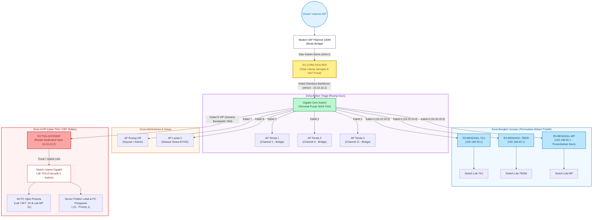

# Panduan Lengkap Simulasi Jaringan Sekolah di GNS3
## Arsitektur Distribusi 4-Router (Zero-Cost Optimization) — SMK Informatika Pasundan

| Informasi Dokumen | Keterangan |
|---|---|
| **Mata Kuliah** | Proyek Konsultansi — Kelas 5A SISTEL |
| **Mitra** | SMK Informatika Pasundan |
| **Fokus Simulasi** | **Validasi Arsitektur Multi-Router (Core, TKA, Bengkel TKJ, Bengkel TBSM)** |
| **Rujukan Desain** | Gambar 5: *Topologi Distribusi Zero Cost (Logika Pemecahan Beban 3+1 Router)* |
| **Platform** | GNS3 Local Server (Windows) + Cloud1 Node + MikroTik CHR + Winbox |
| **Status File** | **Revisi Terbaru (Multi-Router Architecture)** |

---

## 1. Konsep Arsitektur & Diagram Topologi

Daripada memaksakan 1 unit router hAP lite menanggung beban seluruh sekolah, desain ini memanfaatkan stok **20 router MikroTik hAP lite idle** milik sekolah untuk memecah beban komputasi menjadi **4 Router Independen**:



---

## 2. Preview & Skema Pengkabelan Virtual di GNS3

Di kanvas GNS3 Anda, letakkan komponen berikut:

```
                      [ Cloud1 (Wi-Fi/LAN Laptop) ]
                                    │
                                 (ether0)
                         ┌──────────┴──────────┐
                         │   R1-CORE-ROUTER    │
                         └──────────┬──────────┘
                                 (ether1)
                                    │
                      ┌─────────────┴─────────────┐
                      │    GIGABIT-CORE-SWITCH    │
                      │  (Ethernet Switch 16 Port)│
                      └─┬─────────┬─────────┬───┬─┘
                        │         │         │   │
          ┌─────────────┘         │         │   └──────────────┐
     (Port 9 VIP)             (Port 4)  (Port 5)          (Port 1, 2, 3)
          │                       │         │                  │
       (ether0)                (ether0)  (ether0)       ┌──────┴──────┐
┌─────────┴─────────┐   ┌─────────┴───┐ ┌───┴─────────┐ │ 3 AP Tenda  │
│  R2-TKA-GATEWAY   │   │R3-BENGKELTKJ│ │R4-BENGKELTBS│ │ (Ruang Guru)│
└─┬───────┬───────┬─┘   └──────┬──────┘ └──────┬──────┘ └─────────────┘
  │       │       │            │               │
(eth1)  (eth2)  (eth3)      (eth1)          (eth1)
  │       │       │            │               │
[SW-TJKT][SW-MP][SW-PRK]    [PC-TKJ]        [PC-TBSM]
  │       │       │
[VPCS]  [VPCS]  [VPCS]
```

### Tabel Rencana Alokasi Subnet (IP Addressing Plan)

| Perangkat / Segmen | Interface | Alokasi IP Address | Keterangan |
|---|---|---|---|
| **R1-CORE-ROUTER (WAN)** | `ether0` | DHCP dari `Cloud1` | Terhubung ke internet laptop |
| **Backbone Distribusi** | `ether1` | `10.10.10.1/24` | Gateway untuk seluruh router cabang & AP |
| **Ruang Guru (AP 1, 2, 3)** | Via Core Switch | `10.10.10.11 - 10.10.10.13` | Mode Bridge (DHCP dari Core Router) |
| **R2-TKA-GATEWAY (Uplink)** | `ether0` | `10.10.10.2/24` | Jalur Kabel 9 VIP (Garansi Bandwidth) |
| ↳ Lab TJKT (42 PC) | `ether1` | `192.168.20.1/24` | Subnet CBT TJKT (`.10` - `.60`) |
| ↳ Lab MP (40 PC) | `ether2` | `192.168.21.1/24` | Subnet CBT MP (`.10` - `.60`) |
| ↳ Ruang Proktor | `ether3` | `192.168.22.1/24` | Subnet Server & Proktor (`.10` - `.20`) |
| **R3-BENGKEL-TKJ** | `ether0` | `10.10.10.3/24` | Uplink dari Core Switch |
| ↳ LAN Bengkel TKJ | `ether1` | `192.168.30.1/24` | Subnet Praktik TKJ |
| **R4-BENGKEL-TBSM** | `ether0` | `10.10.10.4/24` | Uplink dari Core Switch |
| ↳ LAN Bengkel TBSM | `ether1` | `192.168.40.1/24` | Subnet Praktik TBSM |

---

## 3. Langkah Demi Langkah Setup di GNS3

### Langkah 3.1: Konfigurasi Node Cloud1 (Pengganti NAT Node)
Agar tidak muncul error `NAT interface vmnet8 is missing`:
1. Klik kanan node **`Cloud1`** $\rightarrow$ pilih **Configure**.
2. Pada tab **Ethernet interfaces**:
   * Pilih koneksi laptop Anda yang aktif (**Wi-Fi** atau **Ethernet**).
   * Klik tombol **Add** $\rightarrow$ klik **Apply** $\rightarrow$ **OK**.

### Langkah 3.2: Menambahkan 4 Router MikroTik
1. Tarik template `MikroTik-CHR` ke kanvas sebanyak **4 unit**.
2. Klik kanan pada masing-masing router $\rightarrow$ pilih **Change hostname**:
   * Router 1: `R1-CORE-ROUTER`
   * Router 2: `R2-TKA-GATEWAY`
   * Router 3: `R3-BENGKEL-TKJ`
   * Router 4: `R4-BENGKEL-TBSM`
3. Tarik **1 unit Ethernet Switch** bawaan GNS3, beri nama `GIGABIT-CORE-SWITCH` (atur port menjadi 16 port).
4. Tarik switch-switch lab dan beberapa node **VPCS** untuk simulasi klien.

### Langkah 3.3: Menyambungkan Kabel
1. **Cloud1 ke Core**: Sambungkan `Cloud1` (pilih Wi-Fi/Ethernet) ke `R1-CORE-ROUTER` port `ether0`.
2. **Core ke Switch Utama**: Sambungkan `R1-CORE-ROUTER` port `ether1` ke `GIGABIT-CORE-SWITCH` port 1.
3. **Switch Utama ke Router Cabang**:
   * Port 4 Switch $\rightarrow$ `R3-BENGKEL-TKJ` port `ether0`.
   * Port 5 Switch $\rightarrow$ `R4-BENGKEL-TBSM` port `ether0`.
   * Port 9 Switch $\rightarrow$ `R2-TKA-GATEWAY` port `ether0` *(Kabel VIP TKA)*.
4. **Router TKA ke Switch Lab**:
   * `ether1` $\rightarrow$ Switch Lab TJKT $\rightarrow$ VPCS TJKT.
   * `ether2` $\rightarrow$ Switch Lab MP $\rightarrow$ VPCS MP.
   * `ether3` $\rightarrow$ Switch Proktor $\rightarrow$ VPCS Proktor.
5. Klik tombol **Play (Start all nodes)** di toolbar atas.

---

## 4. Skrip Konfigurasi MikroTik

### 4.1 Skrip R1-CORE-ROUTER (Otak Utama Jaringan)
Buka Console atau Winbox `R1-CORE-ROUTER`, lalu jalankan:

```routeros
# 1. IDENTITAS ROUTER
/system identity set name="R1-CORE-ROUTER"

# 2. INTERFACE NAMING
/interface ethernet
set [ find default-name=ether1 ] name=ether1-WAN comment="Uplink Internet Cloud1"
set [ find default-name=ether2 ] name=ether2-DISTRIBUSI comment="Ke Gigabit Core Switch Ruang Guru"

# 3. IP ADDRESS & WAN CLIENT
/ip dhcp-client add interface=ether1-WAN disabled=no add-default-route=yes use-peer-dns=yes
/ip address add address=10.10.10.1/24 interface=ether2-DISTRIBUSI comment="Gateway Backbone Distribusi"

# 4. DNS & NAT MASQUERADE
/ip dns set allow-remote-requests=yes servers=8.8.8.8,1.1.1.1
/ip firewall nat add chain=srcnat out-interface=ether1-WAN action=masquerade comment="NAT Pusat Sekolah"

# 5. STATIC ROUTING KE SUBNET LAB & BENGKEL
/ip route
add dst-address=192.168.20.0/24 gateway=10.10.10.2 comment="Rute ke Lab TJKT via R2"
add dst-address=192.168.21.0/24 gateway=10.10.10.2 comment="Rute ke Lab MP via R2"
add dst-address=192.168.22.0/24 gateway=10.10.10.2 comment="Rute ke Proktor via R2"
add dst-address=192.168.30.0/24 gateway=10.10.10.3 comment="Rute ke Bengkel TKJ via R3"
add dst-address=192.168.40.0/24 gateway=10.10.10.4 comment="Rute ke Bengkel TBSM via R4"

# 6. QUEUE TREE PUSAT (ALOKASI BANDWIDTH UTAMA)
/queue tree
add name=TOTAL-DOWNLOAD parent=global max-limit=95M
add name=Q-JALUR-VIP-TKA parent=TOTAL-DOWNLOAD limit-at=75M max-limit=90M priority=1 dst=10.10.10.2 comment="Garansi 75 Mbps Jalur TKA"
add name=Q-RUANG-GURU     parent=TOTAL-DOWNLOAD limit-at=10M max-limit=30M priority=3 dst=10.10.10.0/24 comment="Ruang Guru & Distribusi"
add name=Q-BENGKEL        parent=TOTAL-DOWNLOAD limit-at=5M  max-limit=15M priority=5 dst=10.10.10.3,10.10.10.4 comment="Bengkel Jurusan"
```

---

### 4.2 Skrip R2-TKA-GATEWAY (Router Khusus Lab CBT)
Buka Console atau Winbox `R2-TKA-GATEWAY`, lalu jalankan:

```routeros
# 1. IDENTITAS ROUTER
/system identity set name="R2-TKA-GATEWAY"

# 2. INTERFACE NAMING
/interface ethernet
set [ find default-name=ether1 ] name=ether1-UPLINK comment="Dari Core Switch (Kabel VIP)"
set [ find default-name=ether2 ] name=ether2-LAB-TJKT comment="Ke Switch Lab TJKT (42 PC)"
set [ find default-name=ether3 ] name=ether3-LAB-MP comment="Ke Switch Lab MP (40 PC)"
set [ find default-name=ether4 ] name=ether4-PROKTOR comment="Ke Switch Server Proktor"

# 3. IP ADDRESS & DEFAULT GATEWAY KE CORE
/ip address
add address=10.10.10.2/24 interface=ether1-UPLINK comment="IP Uplink R2"
add address=192.168.20.1/24 interface=ether2-LAB-TJKT comment="Gateway Lab TJKT"
add address=192.168.21.1/24 interface=ether3-LAB-MP comment="Gateway Lab MP"
add address=192.168.22.1/24 interface=ether4-PROKTOR comment="Gateway Proktor"

/ip route add dst-address=0.0.0.0/0 gateway=10.10.10.1 comment="Default Route ke Core Router"
/ip dns set allow-remote-requests=yes servers=10.10.10.1,8.8.8.8

# 4. DHCP POOL & SERVER LAB TKA
/ip pool
add name=pool-tjkt ranges=192.168.20.10-192.168.20.60
add name=pool-mp ranges=192.168.21.10-192.168.21.60
add name=pool-proktor ranges=192.168.22.10-192.168.22.20

/ip dhcp-server
add address-pool=pool-tjkt disabled=no interface=ether2-LAB-TJKT lease-time=3d name=dhcp-tjkt
add address-pool=pool-mp disabled=no interface=ether3-LAB-MP lease-time=3d name=dhcp-mp
add address-pool=pool-proktor disabled=no interface=ether4-PROKTOR lease-time=3d name=dhcp-proktor

/ip dhcp-server network
add address=192.168.20.0/24 dns-server=192.168.20.1,8.8.8.8 gateway=192.168.20.1
add address=192.168.21.0/24 dns-server=192.168.21.1,8.8.8.8 gateway=192.168.21.1
add address=192.168.22.0/24 dns-server=192.168.22.1,8.8.8.8 gateway=192.168.22.1

# 5. MANGLE & PCQ FAIRNESS LAB TKA
/ip firewall address-list
add address=192.168.20.0/24 list=LIST-TKA
add address=192.168.21.0/24 list=LIST-TKA
add address=192.168.22.0/24 list=LIST-PROKTOR

/ip firewall mangle
add chain=forward src-address-list=LIST-PROKTOR action=mark-connection new-connection-mark=conn-proktor passthrough=yes
add chain=forward connection-mark=conn-proktor action=mark-packet new-packet-mark=pkt-proktor passthrough=no
add chain=forward src-address-list=LIST-TKA action=mark-connection new-connection-mark=conn-tka passthrough=yes
add chain=forward connection-mark=conn-tka src-address-list=LIST-TKA action=mark-packet new-packet-mark=pkt-tka-up passthrough=no
add chain=forward connection-mark=conn-tka dst-address-list=LIST-TKA action=mark-packet new-packet-mark=pkt-tka-down passthrough=no

/queue type
add name=pcq-tka-down kind=pcq pcq-classifier=dst-address pcq-rate=2M
add name=pcq-tka-up   kind=pcq pcq-classifier=src-address pcq-rate=1M

/queue tree
add name=TOTAL-DOWNLOAD parent=global max-limit=80M
add name=Q-PROKTOR-DOWN parent=TOTAL-DOWNLOAD packet-mark=pkt-proktor limit-at=10M max-limit=75M priority=1 queue=default
add name=Q-TKA-DOWN parent=TOTAL-DOWNLOAD packet-mark=pkt-tka-down limit-at=65M max-limit=75M priority=2 queue=pcq-tka-down
```

---

## 5. Pengujian & Verifikasi End-to-End

1. **Uji Klien Lab TKA (VPCS)**:
   * Buka console node `PC-TJKT-01` $\rightarrow$ ketik `ip dhcp`.
   * Pastikan mendapat IP `192.168.20.x` dengan gateway `192.168.20.1`.
   * Lakukan `ping 192.168.20.1` (Gateway R2) $\rightarrow$ **Sukses**.
   * Lakukan `ping 10.10.10.1` (Gateway R1 Core) $\rightarrow$ **Sukses**.
   * Lakukan `ping 8.8.8.8` (Internet Luar via Cloud1) $\rightarrow$ **Reply Sukses**.
2. **Uji Isolasi Antar-Lab**:
   * Coba ping antar PC TJKT ke Server Proktor untuk memvalidasi *inter-VLAN routing*.
3. **Uji Monitoring Bandwidth**:
   * Buka Winbox di `R1-CORE-ROUTER`, lihat menu **Queues** $\rightarrow$ **Queue Tree**.
   * Saat klien TKA mengunduh atau melakukan ping terus-menerus, trafik akan tercatat langsung di baris `Q-JALUR-VIP-TKA`.
