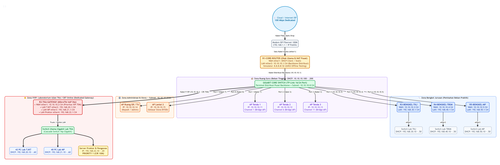
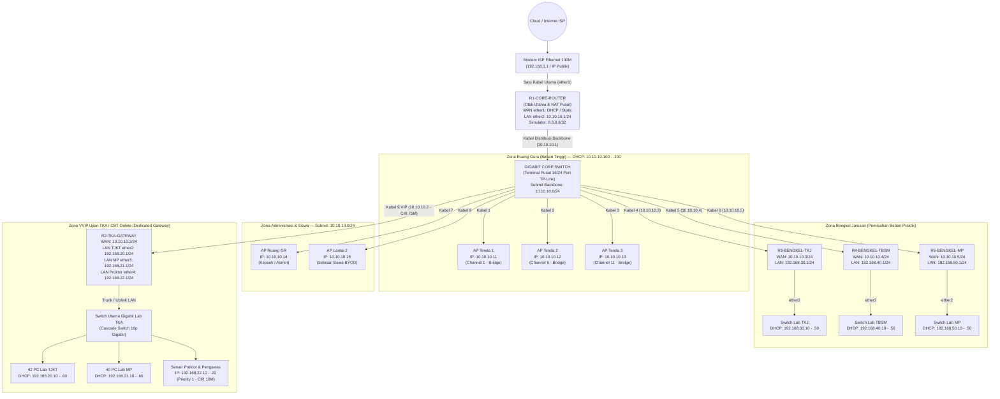

# Optimalisasi Infrastruktur Jaringan & Pengamanan Jalur Ujian TKA
## SMK Informatika Pasundan — Zero-Cost Architecture (Multi-Router Distribution)

[](https://mikrotik.com)
[](https://gns3.com)
[](https://opensource.org/licenses/MIT)

> **Proyek Konsultansi Jaringan — Semester 5 (Kelas 5A SISTEL)**  
> **Mitra Proyek:** SMK Informatika Pasundan  
> **Fokus Utama:** Pengamanan Jalur Ujian CBT TKA (84 PC), Penyelesaian Masalah Wi-Fi Ruang Guru, dan Pemecahan Beban Jaringan Tanpa Pengadaan Alat Baru (*Zero-Cost Optimization*).

---

## 📌 1. Latar Belakang & Permasalahan

Berdasarkan audit infrastruktur jaringan di SMK Informatika Pasundan:
1. **Beban Tinggi Jam Sibuk (08.00–13.00):** Wi-Fi Ruang Guru mengalami gejala *"Terkoneksi tanpa akses"*, *"Sering logout sendiri"*, dan *"Buffering"*.
2. **Keterbatasan Spesifikasi Router:** Router eksisting adalah **MikroTik hAP lite (RB941-2nD)** dengan CPU single-core 650 MHz dan RAM 32MB. Menangani 80+ PC ujian sekaligus bersamaan dengan Wi-Fi guru berisiko memicu CPU 100% dan *freeze*.
3. **Event Berisiko Tinggi (TKA / CBT):** Pelaksanaan ujian melibatkan **84 unit PC** secara simultan di 2 laboratorium (**Lab TJKT: 42 PC** dan **Lab MP: 40 PC**).
4. **Peluang Aset Idle:** Sekolah memiliki **20 unit router MikroTik hAP lite idle** yang belum dimanfaatkan di gudang.

---

## 💡 2. Solusi: Arsitektur Distribusi 5-Router Zero-Cost (Gambar 5 Laporan)

Daripada membeli router enterprise mahal, solusi terbaik adalah **memecah beban komputasi jaringan** menggunakan aset router idle yang sudah dimiliki sekolah:

<p align="center">
  <a href="assets/topologi_distribusi_zero_cost_hd.png">
    
  </a>
  <br>
  <em><b>Gambar 5:</b> Topologi Distribusi Zero-Cost SMK Informatika Pasundan (Klik gambar untuk resolusi 8K Ultra-HD • Tersedia format vektor <a href="assets/topologi_distribusi_zero_cost.svg"><b>SVG</b></a>)</em>
</p>

### Diagram Detail Alur Logis Jaringan:



---

## 📊 3. Master Rencana Pengalamatan IP (IP Addressing Plan)

| No | Perangkat / Segmen | Port / Interface | Alamat IP | Subnet | Gateway | Rentang DHCP Pool | Keterangan |
|:--:|:---|:---:|:---:|:---:|:---:|:---:|:---|
| **1** | **`R1-CORE-ROUTER`** | `ether1` | Sesuai ISP | - | Modem ISP | - | Uplink Utama Internet |
| | | `ether2` | **`10.10.10.1`** | `/24` | - | - | Backbone Distribusi Sekolah |
| | | `loopback` | **`8.8.8.8`** | `/32` | - | - | Simulator Internet (Simulasi) |
| **2** | **Ruang Guru (AP 1, 2, 3)** | LAN | `10.10.10.11 - .13` | `/24` | `10.10.10.1` | - | Bridge Mode (Kanal 1, 6, 11) |
| | **Client Ruang Guru** | WiFi | Dinamis | `/24` | `10.10.10.1` | **`.100 - .200`** | DHCP dari Core Router |
| **3** | **AP Kepsek & Selasar** | LAN | `10.10.10.14 - .15` | `/24` | `10.10.10.1` | - | Bridge Mode |
| **4** | **`R2-TKA-GATEWAY`** | `ether1` | **`10.10.10.2`** | `/24` | `10.10.10.1` | - | Uplink Kabel 9 VIP |
| | ↳ **Lab TJKT (42 PC)** | `ether2` | **`192.168.20.1`** | `/24` | `192.168.20.1` | **`.10 - .60`** | PCQ 2M/1M (Lease 3 Hari) |
| | ↳ **Lab MP (40 PC)** | `ether3` | **`192.168.21.1`** | `/24` | `192.168.21.1` | **`.10 - .60`** | PCQ 2M/1M (Lease 3 Hari) |
| | ↳ **Server Proktor** | `ether4` | **`192.168.22.1`** | `/24` | `192.168.22.1` | **`.10 - .20`** | Priority 1 (CIR 10 Mbps) |
| **5** | **`R3-BENGKEL-TKJ`** | `ether1` | **`10.10.10.3`** | `/24` | `10.10.10.1` | - | Uplink Kabel 4 |
| | ↳ **Praktik TKJ** | `ether2` | **`192.168.30.1`** | `/24` | `192.168.30.1` | **`.10 - .50`** | Limit Simple Queue 15M |
| **6** | **`R4-BENGKEL-TBSM`** | `ether1` | **`10.10.10.4`** | `/24` | `10.10.10.1` | - | Uplink Kabel 5 |
| | ↳ **Praktik TBSM** | `ether2` | **`192.168.40.1`** | `/24` | `192.168.40.1` | **`.10 - .50`** | Limit Simple Queue 10M |
| **7** | **`R5-BENGKEL-MP`** | `ether1` | **`10.10.10.5`** | `/24` | `10.10.10.1` | - | Uplink Kabel 6 |
| | ↳ **Praktik MP** | `ether2` | **`192.168.50.1`** | `/24` | `192.168.50.1` | **`.10 - .50`** | Limit Simple Queue 15M |

---

## 📁 4. Struktur Direktori Repositori

```text
├── Konfigurasi Router & Mikrotik/
│   ├── Simulasi GNS3/                    # Script siap pakai untuk simulasi GNS3 (CHR)
│   │   ├── 01-R1-CORE-ROUTER.rsc         # (Simulator 8.8.8.8, Backbone, Bandwidth Server)
│   │   ├── 02-R2-TKA-GATEWAY.rsc         # (PCQ 2M/1M, Queue Tree, Lab TJKT & MP)
│   │   ├── 03-R3-BENGKEL-TKJ.rsc         # (Subnet 192.168.30.0/24)
│   │   ├── 04-R4-BENGKEL-TBSM.rsc        # (Subnet 192.168.40.0/24)
│   │   ├── 05-R5-BENGKEL-MP.rsc          # (Subnet 192.168.50.0/24)
│   │   └── README-SIMULASI-GNS3.md       # Panduan pengujian GNS3 & VPCS
│   │
│   └── Implementasi Asli/                # Script untuk hardware fisik MikroTik hAP lite
│       ├── 01-R1-CORE-ROUTER.rsc         # (ISP Fibernet 100M, FastTrack bypass)
│       ├── 02-R2-TKA-GATEWAY.rsc         # (Lightweight Mangle hemat CPU 650 MHz)
│       ├── 03-R3-BENGKEL-TKJ.rsc         # (Subnet Praktik TKJ)
│       ├── 04-R4-BENGKEL-TBSM.rsc        # (Subnet Praktik TBSM)
│       ├── 05-R5-BENGKEL-MP.rsc          # (Subnet Praktik MP)
│       └── README-IMPLEMENTASI-ASLI.md   # SOP Reset & Wiring Fisik
│
├── Data Sekolah/                         # Foto survei lapangan & backup eksisting
├── Dokumen PDF/                          # Berkas PDF laporan resmi proyek konsultasi
├── assets/                               # Diagram arsitektur & fishbone SVG
│
├── Laporan Komprehensif Optimalisasi Jaringan SMK Informatika Pasundan.docx # Berkas Laporan Utama
├── Analisis dan Strategi Prioritas TKA.md
├── Brainstorming dan Analysis Plan.md
├── Panduan Simulasi GNS3 dan Implementasi MikroTik.md
├── Instrumen Pengumpulan Data.md
├── Spesifikasi Infrastruktur Sekolah.md
└── Objektif.md
```

---

## 🚀 5. Cara Penggunaan

### A. Untuk Simulasi di GNS3:
1. Buka project di **GNS3**, pastikan node router menggunakan template **MikroTik CHR**.
2. Buka terminal console masing-masing router.
3. Import atau copy-paste isi file dari folder `Konfigurasi Router & Mikrotik/Simulasi GNS3/`.
4. Uji koneksi internet simulator: `/ping 8.8.8.8` dari router mana pun.
5. Panduan lengkap pengujian ada di [README-SIMULASI-GNS3.md](file:///d:/Belajar/Semester%205/Project/Project%20Konsultasi/Konfigurasi%20Router%20&%20Mikrotik/Simulasi%20GNS3/README-SIMULASI-GNS3.md).

### B. Untuk Implementasi Hardware Asli:
1. Reset router hAP lite: **No Default Configuration** & **Do Not Backup**.
2. Login Winbox via MAC Address.
3. Paste script dari folder `Konfigurasi Router & Mikrotik/Implementasi Asli/`.
4. Panduan kabel dan SOP hari-H ujian tersedia di [README-IMPLEMENTASI-ASLI.md](file:///d:/Belajar/Semester%205/Project/Project%20Konsultasi/Konfigurasi%20Router%20&%20Mikrotik/Implementasi%20Asli/README-IMPLEMENTASI-ASLI.md).

---

## 👥 Tim Konsultan
* **Muhammad Muhibin** — Sistem Telekomunikasi (Kelas 5A SISTEL)
* **Mitra:** SMK Informatika Pasundan
